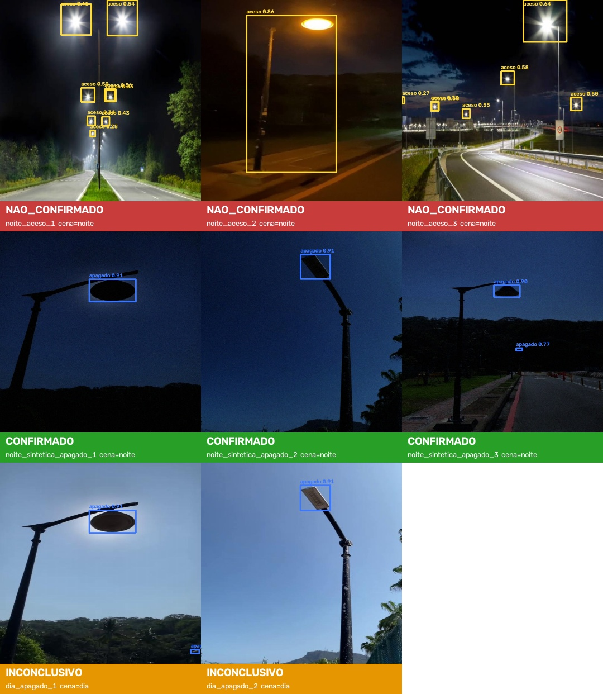

# Rua Acesa — Visão (Applied Computer Vision)

Componente de **visão computacional** do [Rua Acesa](#o-rua-acesa-em-uma-frase), produto da Global Solution 2026.2 (CitizenTech · Engenharia de Software 4º ano · FIAP).

Um **YOLO26 treinado sob medida** detecta **postes acesos e apagados** em fotos. Exposto como API, ele confirma se um relato de "poste apagado" procede antes de o relato virar solicitação à Prefeitura.

> Este repositório contém **apenas** o componente de visão. As outras disciplinas (dados, LLM, RPA, IoT, DevOps e negócio) consomem a API descrita abaixo.

| Item | Link |
| --- | --- |
| Repositório | [github.com/GabrielDiegues/gs-computer-vision-2.2026](https://github.com/GabrielDiegues/gs-computer-vision-2.2026) |
| Vídeo de demonstração (YouTube, não listado) | _a preencher_ |
| Relatório técnico (PDF) | [`docs/relatorio.pdf`](docs/relatorio.pdf) |

---

## O Rua Acesa em uma frase

Ruas com poste apagado deixam o trajeto noturno inseguro. Com o Rua Acesa, o cidadão (ou o robô de inspeção) registra o ponto escuro com foto, a IA confirma e prioriza, e o sistema encaminha a solicitação e mostra no mapa onde a cidade está escura.

### Onde a visão entra

```
Cidadão / robô ──foto──▶ API central ──▶ n8n (RPA) ──POST /detect──▶ [ ESTE REPOSITÓRIO ]
                                              │                        YOLO26 + regra de decisão
                                              ◀── veredito JSON ───────┘
                                              │
                    confirmado ──▶ deduplica por poste, prioriza, fila de revisão humana
                    inconclusivo ─▶ revisão humana / pedir nova foto à noite
                    nao_confirmado ▶ relato arquivado com justificativa
```

**IA responsável:** o modelo **sugere** e uma pessoa revisa a fila antes de qualquer envio à Prefeitura. A imagem é processada em memória e **não é armazenada** (LGPD).

---

## Resultados

YOLO26s com fine-tuning de 47,6 min (RTX 4060), avaliado num conjunto de teste nunca visto no treino:

| Cenário de teste | Imagens | mAP50 | mAP50-95 | mAP50 poste_apagado | Recall poste_apagado |
| --- | --- | --- | --- | --- | --- |
| Completo | 281 | **0,766** | 0,411 | **0,840** | 0,838 |
| Só fotos noturnas reais | 47 | **0,823** | 0,467 | 0,898 | 0,867 |
| Teste diurno convertido em noite | 234 | **0,734** | 0,376 | 0,831 | 0,847 |

**Ablação.** Treinamos o mesmo modelo **sem a noite sintética** para medir o efeito dela:

| Cenário | mAP50 apagado (final → sem noite sintética) | Recall apagado (final → sem) |
| --- | --- | --- |
| Completo | 0,840 → 0,834 | 0,838 → 0,790 |
| Noite real (só 15 caixas de apagado) | 0,898 → 0,887 | 0,867 → 0,867 |
| **Teste convertido em noite** | **0,831 → 0,433** | **0,847 → 0,498** |

Nas fotos como vêm nos datasets os dois modelos empatam. Num poste apagado à noite, porém, o modelo sem a correção perde metade das detecções: ele tinha aprendido "céu claro = apagado".

- Inferência: cerca de 6 ms por imagem na GPU.
- O modelo quase nunca troca aceso por apagado (2%). O erro mais comum é marcar como "aceso" outras fontes de luz, como faróis e janelas.
- Métricas completas em [`docs/metricas/`](docs/metricas/), figuras em [`docs/img/`](docs/img/) e análise no [relatório](docs/relatorio.pdf).



---

## Como rodar

Requisitos: Python 3.12 e GPU NVIDIA (opcional, recomendada para treinar; a inferência roda em CPU).

```bash
python3 -m venv .venv && source .venv/bin/activate
pip install -r requirements.txt
cp .env.example .env        # coloque sua ROBOFLOW_API_KEY (gratuita) para baixar os dados
```

### 1. Dados

```bash
cd scripts
python download_datasets.py   # baixa os datasets de configs/datasets.yaml para datasets/raw/
python merge_remap.py         # unifica em datasets/rua_acesa/ (2 classes, split 70/20/10)
python dataset_stats.py       # contagens por classe/cena + docs/img/amostras_dataset.jpg
```

### 2. Treino e avaliação

```bash
python train.py                 # fine-tuning do yolo26s.pt (COCO) -> models/best.pt
python evaluate.py                             # teste completo -> docs/metricas/test_completo.json
python evaluate.py --cenario noite             # só as fotos noturnas reais do teste
python evaluate.py --cenario noite_sintetica   # teste diurno convertido em noite
python examples_figure.py                      # docs/img/exemplos_resultados.jpg

# ablação: mesmo pipeline sem a noite sintética
python merge_remap.py --night-synth 0 --out ../datasets/ablacao_sem_noite
python train.py --data ../datasets/ablacao_sem_noite/data.yaml --name ablacao_sem_noite --no-export
python evaluate.py --weights ../runs/ablacao_sem_noite/weights/best.pt --cenario noite_sintetica --tag ablacao_sem_noite
```

### 3. Demonstração

```bash
python predict.py --source ../samples/           # pasta de imagens, 3 s cada (--pausa 0 avança com tecla; q sai)
python predict.py --source video_noturno.mp4     # vídeo
python predict.py --source 0                     # webcam, detecção em tempo real
```

O vídeo de demonstração (`docs/video/demo_rua_acesa.mp4`, sem áudio) é gerado pela execução real da solução: o modelo roda em cada quadro, e a API sobe e responde a requisições `curl` de verdade.

```bash
python make_demo_video.py   # requer: python evaluate.py --cenario noite_sintetica
```

### 4. API (contrato consumido pelo n8n)

```bash
uvicorn app.main:app --host 0.0.0.0 --port 8000   # na raiz do repositório
# Swagger em http://localhost:8000/docs
curl -F "file=@samples/noite_sintetica_apagado_2.jpg" http://localhost:8000/detect
```

`POST /detect` (multipart, campo `file`, JPEG/PNG/WebP até 10 MB). Resposta real para `samples/noite_sintetica_apagado_2.jpg`:

```json
{
  "veredito": "confirmado",
  "motivo": "1 poste(s) apagado(s) com confiança ≥ 0.5",
  "cena": "noite",
  "brilho_medio": 69.8,
  "deteccoes": [
    {"classe": "poste_apagado", "confianca": 0.9071, "bbox": [317.1, 73.2, 411.0, 151.8]}
  ],
  "largura": 640, "altura": 640,
  "modelo": "best.pt",
  "tempo_ms": 27.6
}
```

| Veredito | Quando | O que o n8n faz |
| --- | --- | --- |
| `confirmado` | foto noturna com `poste_apagado` de confiança ≥ 0,5 | segue para deduplicação, priorização e fila de revisão |
| `nao_confirmado` | foto noturna só com `poste_aceso` de confiança ≥ 0,5 | arquiva com justificativa e avisa o cidadão |
| `inconclusivo` | nenhum poste confiável **ou foto diurna** (poste desligado de dia é o esperado) | revisão humana / pede nova foto à noite |

`GET /health` devolve o status, o modelo carregado e as classes. Variáveis opcionais no `.env`: `MODEL_PATH`, `CONF_THRESHOLD`, `VERDICT_THRESHOLD` e `MAX_UPLOAD_MB`.

---

## Dados

Somente datasets públicos do Roboflow Universe, todos **CC BY 4.0**:

| Dataset | Classes originais → Rua Acesa |
| --- | --- |
| [teja-swloz/light-detection](https://universe.roboflow.com/teja-swloz/light-detection-ebxml) | Lights-on → aceso · Lights-off → apagado · Pole → descartada |
| [teja-swloz/pole](https://universe.roboflow.com/teja-swloz/pole-p1ls9) | idem |
| [project-sbybw/streetlighttest](https://universe.roboflow.com/project-sbybw/streetlighttest) | streetlight{1,2}on → aceso · streetlight{1,2}off → apagado |
| [gb-edrki/streetLight](https://universe.roboflow.com/gb-edrki/streetlight-igcyd) | light_on → aceso · light_off → apagado |
| [datasets-cobjh/street_light_on](https://universe.roboflow.com/datasets-cobjh/street_light_on) | street_lamp_on → aceso |

Os datasets avaliados e descartados, com o motivo, estão em [`configs/datasets.yaml`](configs/datasets.yaml).

### Tratamento (`scripts/merge_remap.py`)

1. **Remapeamento** dos nomes de classe por regras (`off`, `on` etc.). Imagens com poste sem estado definido são descartadas.
2. **Deduplicação** exata (MD5) e perceptual (dHash, ≤ 4 bits), mantendo **uma imagem por foto de origem**. Os datasets públicos vinham inflados por cópias aumentadas e quadros de vídeo quase idênticos, e sem isso a mesma foto cairia no treino e no teste.
3. **Split 70/20/10** estratificado pela presença de `poste_apagado`.
4. **Correção de atalhos** (só no treino):
   - **Noite sintética:** quase todo `poste_apagado` público é foto **diurna**, e um modelo treinado assim aprende "céu claro = apagado". Metade dessas fotos ganha uma versão escurecida (gama, tom azulado e ruído de sensor), em que a lâmpada continua sem brilho próprio.
   - **Cópias em cinza:** um dos datasets é todo em tons de cinza e concentra os `poste_apagado`. Parte das fotos coloridas com `poste_aceso` ganha uma cópia em cinza, para a cor não virar pista.

---

## Estrutura

```
app/            API FastAPI (main.py), detector + regra de decisão, guarda dia/noite, contrato
scripts/        download, unificação, estatísticas, treino, avaliação, inferência, figura de exemplos, PDF, vídeo
configs/        datasets usados (e descartados, com motivo)
models/best.pt  pesos treinados
docs/           vídeo de demonstração, relatório (md + pdf; gere com `pip install -r requirements-docs.txt && python scripts/build_report.py`), métricas e figuras
samples/        imagens do teste para a demo e a API (as "noite_sintetica" são fotos diurnas convertidas)
```

## Equipe

| Nome | RM |
| --- | --- |
| Gabriel Diegues Figueiredo Rocha | 550788 |
| Pedro Henrique Palladino | 551180 |
| Pedro Henrique Pontes | 98036 |
| Raí Gumieri dos Santos | 98287 |
