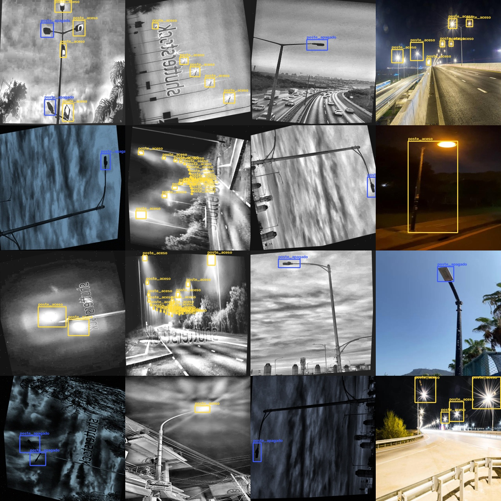
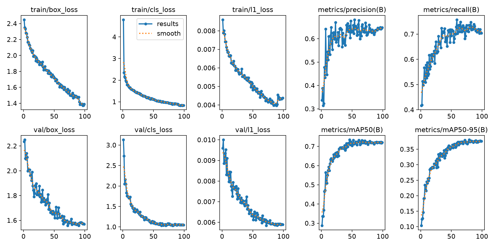
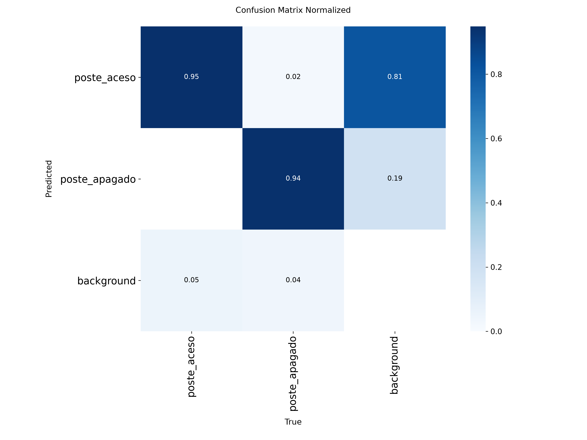
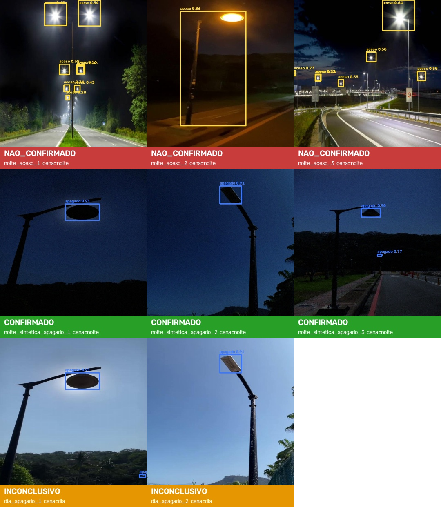

# Rua Acesa — Visão: detecção de postes apagados com YOLO26

**Global Solution 2026.2 · CitizenTech · Applied Computer Vision**
Engenharia de Software · 4º ano · FIAP · Professores Arnaldo Viana e Paulo Rodrigues

**Integrantes:** Gabriel Diegues Figueiredo Rocha (RM 550788) · Henrique Pontes (RM 98036) · Pedro Henrique Palladino (RM 551180)  · Raí Gumieri dos Santos (RM 98287)

**Repositório:** [github.com/GabrielDiegues/gs-computer-vision-2.2026](https://github.com/GabrielDiegues/gs-computer-vision-2.2026) · **Vídeo:** https://youtu.be/EDIOxa15RME

## Resumo

Ruas com poste apagado tornam o trajeto noturno inseguro, e a fiscalização da iluminação pública depende de relatos que nem sempre procedem. Este trabalho apresenta o componente de visão computacional do Rua Acesa, plataforma cidadã que recebe fotos de pontos escuros em São Paulo. Treinamos de forma customizada um detector YOLO26s, pré-treinado no COCO, para reconhecer duas classes: poste aceso e poste apagado. Os dados vieram de cinco datasets públicos do Roboflow Universe, unificados por remapeamento de classes e por deduplicação exata e perceptual, que reduziu cerca de 15 mil arquivos a 2.814 fotos de origem e eliminou o vazamento entre treino e teste. A auditoria dos dados revelou que quase todo poste apagado público foi fotografado de dia; para impedir que o modelo aprendesse "céu claro significa apagado", geramos versões noturnas sintéticas dessas fotos apenas no conjunto de treino. Uma ablação mostrou o efeito: sem essa correção, o mAP50 de poste apagado no teste convertido para noite cai de 0,831 para 0,433. No teste, o modelo atingiu mAP50 de 0,766 (0,840 para poste apagado), 0,823 nas fotos noturnas reais e 0,734 no teste convertido para noite, com cerca de 6 ms por imagem em uma RTX 4060. O modelo é servido por uma API FastAPI consumida pelo fluxo de automação do produto: ela devolve um veredito (confirmado, não confirmado ou inconclusivo), trata fotos diurnas como inconclusivas e não armazena imagens, mantendo uma pessoa na revisão antes de qualquer envio à Prefeitura.

## Introdução

Quem circula a pé à noite em São Paulo — trabalhadores que voltam tarde, estudantes, mulheres, quem espera ônibus — depende da iluminação pública para se sentir seguro. A cidade tem mais de 600 mil pontos de luz, e um poste apagado pode passar semanas sem reparo, seja porque o cidadão não sabe reclamar, seja porque não acompanha o pedido. O Rua Acesa é uma plataforma de fiscalização cidadã da iluminação: o cidadão, ou um robô de inspeção, registra o ponto escuro com uma foto; o sistema confirma, prioriza, encaminha a solicitação e mostra no mapa onde a cidade está escura.

Cada disciplina da Global Solution constrói um componente do mesmo produto. Este documento trata do componente de **visão**: o modelo que olha a foto do relato e diz se ali há, de fato, um poste apagado. Sem essa etapa, a fila de solicitações se enche de fotos erradas, repetidas ou tiradas de dia, e a equipe de revisão perde tempo. Com ela, o fluxo automatizado (n8n) recebe um veredito estruturado e só encaminha para revisão humana o que tem evidência.

## Objetivo

Treinar e disponibilizar, via API, um detector de objetos YOLO26 que identifique postes acesos e apagados em fotos de relatos noturnos, confirmando automaticamente se o relato procede e encaminhando casos incertos para revisão humana, com desempenho mínimo de mAP50 igual a 0,6 no conjunto de teste.

## Explicação técnica das ferramentas

**YOLO26 (Ultralytics).** Família de detectores de objetos de estágio único: uma só passada pela rede prevê caixas e classes. A versão 26 dispensa a etapa de NMS (supressão de não máximos) e a perda DFL, o que simplifica a exportação e acelera a inferência em CPU e em dispositivos embarcados, um ponto relevante para o robô de inspeção. Usamos a variante **s** (cerca de 10 milhões de parâmetros, 23 GFLOPs), pré-treinada no COCO, e fizemos *fine-tuning* (aprendizado por transferência) para as duas classes do problema.

**PyTorch + CUDA.** Base do treino, feito em uma GPU NVIDIA RTX 4060 (8 GB). O *AutoBatch* da Ultralytics escolhe o tamanho de lote que cabe em 70% da memória.

**OpenCV e NumPy.** Leitura e escrita de imagens, deduplicação perceptual (dHash), estimativa de cena dia/noite (média do canal V do HSV) e as transformações de dados descritas na metodologia.

**Roboflow Universe.** Repositório de datasets públicos anotados; baixamos cinco datasets CC BY 4.0 em formato YOLO pela biblioteca `roboflow`, com a chave de API fora do código (arquivo `.env`).

**FastAPI + Uvicorn.** Expõem o modelo como serviço HTTP (`POST /detect`) com contrato validado por Pydantic e documentação Swagger automática. É por essa API que o fluxo n8n (disciplina de RPA) integra a visão ao produto.

**Métricas.** *Precisão* (das caixas previstas, quantas estão certas), *recall* (dos postes reais, quantos foram achados), **mAP50** (média, entre as classes, da área sob a curva precisão × recall, com acerto definido por IoU ≥ 0,5) e **mAP50-95** (a mesma média, variando o IoU de 0,5 a 0,95, que é mais exigente quanto ao ajuste da caixa).

## Metodologia

O código de cada etapa está em `scripts/` e roda na ordem abaixo; todos os números citados saem desses scripts.

### 1. Definição do problema e das classes

A pergunta que o produto precisa responder é: "nesta foto há um poste apagado?". Optamos por **duas classes**, `poste_aceso` e `poste_apagado`. A classe "aceso" é necessária para o modelo distinguir os dois estados, em vez de apenas localizar postes; ela também permite rejeitar relatos de postes que estão funcionando.

### 2. Coleta (`download_datasets.py`)

Buscamos no Roboflow Universe datasets de detecção com estado da lâmpada anotado. Inspecionamos visualmente cada candidato antes de usá-lo e descartamos quatro (registrados em `configs/datasets.yaml`):

- um conjunto de 505 imagens que, na verdade, era formado por ~5 fotos de banco de imagens rotacionadas centenas de vezes, com caixas sobre prédios;
- um projeto de classificação, sem caixas;
- um cuja versão publicada não tinha estado da lâmpada;
- um com caixas do tamanho da imagem inteira.

Ficaram cinco datasets, todos CC BY 4.0.

### 3. Unificação e limpeza (`merge_remap.py`)

| Etapa | Efeito |
| --- | --- |
| Remapeamento por regras (`off` → apagado, `on` → aceso; "Pole" etc. descartados) | 2 classes comuns |
| Deduplicação exata (MD5) | remove arquivos idênticos |
| Uma imagem por foto de origem (sufixo `.rf.` do Roboflow) | remove cópias aumentadas pelos autores |
| Deduplicação perceptual (dHash 64 bits, distância ≤ 4) | remove quadros de vídeo e fotos quase idênticas, inclusive entre datasets |
| Split 70/20/10 estratificado pela presença de `poste_apagado` | treino 1.970 · validação 563 · teste 281 |

A deduplicação foi decisiva: os datasets somavam cerca de 15 mil arquivos, mas apenas 2.814 fotos distintas (de 6.479 grupos de origem, 3.665 eram quase duplicatas). Sem ela, versões da mesma foto cairiam no treino e no teste, e as métricas ficariam artificialmente altas.

### 4. Auditoria de vieses e correção de atalhos

Medimos o brilho médio de cada foto (canal V do HSV; abaixo de 90 = noite) e cruzamos com as classes. O resultado mostrou um **atalho perigoso**: quase todo `poste_apagado` público é foto **diurna**, enquanto o `poste_aceso` aparece majoritariamente à noite. Um modelo treinado assim poderia aprender "céu claro = apagado", e falharia justamente no caso de uso do produto, que é a foto noturna. Um segundo atalho: um dos datasets é todo em tons de cinza e concentra os postes apagados.

Aplicamos duas correções **somente no treino** (validação e teste permanecem 100% reais):

- **Noite sintética:** metade das fotos diurnas com poste apagado ganhou uma cópia "noturna" (curva gama de 2 a 3, redução de brilho, tom azulado e ruído gaussiano de sensor), totalizando 537 imagens. Como a lâmpada apagada não tem brilho próprio, ela continua escura na versão noturna, e o modelo é forçado a olhar a luminária, não o céu.
- **Cópias em cinza:** 125 fotos coloridas com poste aceso ganharam uma cópia em cinza com equalização CLAHE, para a cor não virar pista de classe.

Distribuição final de caixas:

| Split | Imagens | Sintéticas | aceso/dia | aceso/noite | apagado/dia | apagado/noite |
| --- | --- | --- | --- | --- | --- | --- |
| Treino | 2.632 | 662 | 7.597 | 1.945 | 2.007 | 1.040 |
| Validação | 563 | 0 | 2.017 | 265 | 597 | 13 |
| Teste | 281 | 0 | 903 | 151 | 281 | 15 |

<div class="fig" markdown="1">

{: style="width:60%"}
<em class="legenda">Figura 1 — Amostras do treino com as caixas unificadas (amarelo: aceso; azul: apagado).</em>

</div>

### 5. Treinamento (`train.py`)

*Fine-tuning* do `yolo26s.pt` com os seguintes parâmetros:

| Parâmetro | Valor | Justificativa |
| --- | --- | --- |
| Resolução | 640 px | padrão do modelo; as luminárias são objetos pequenos |
| Épocas | até 100, *early stopping* com paciência 20 | parou na época 99; melhor época: 79 |
| Lote | 14 (AutoBatch, 70% de 8 GB) | maior lote que cabe na GPU |
| Otimizador | AdamW, lr 0,00167, decaimento cosseno | escolha automática da Ultralytics |
| Augmentação | mosaico (desligado nas 10 últimas épocas), flip horizontal, HSV (s = 0,6; v = 0,5) | variação de brilho é crítica em cenas noturnas |

O treino levou **47,6 minutos** em uma RTX 4060.

<div class="fig" markdown="1">


<em class="legenda">Figura 2 — Perdas e métricas de validação ao longo das épocas.</em>

</div>

### 6. Avaliação (`evaluate.py`)

O modelo final (melhor época) foi avaliado em três cenários do conjunto de teste, nunca visto no treino:

1. **completo**: as 281 imagens;
2. **noite**: apenas as 47 fotos noturnas reais;
3. **noite sintética**: as 234 fotos diurnas convertidas para noite com a mesma transformação do treino. Esse cenário mede o risco central do produto, um poste apagado à noite, que quase não existe em dados reais.

Para medir o efeito da noite sintética, treinamos também um **modelo de ablação**, idêntico mas sem ela, e o avaliamos nos mesmos cenários.

### 7. Integração (`app/`)

A API FastAPI carrega o modelo uma vez e expõe `POST /detect`. A regra de decisão transforma as detecções em um veredito:

- **confirmado**: foto noturna com `poste_apagado` de confiança ≥ 0,5;
- **não confirmado**: foto noturna apenas com `poste_aceso` de confiança ≥ 0,5;
- **inconclusivo**: nenhum poste confiável, **ou foto diurna**, já que de dia o poste fica desligado por projeto e a foto não prova defeito.

A API valida o tipo e o tamanho do arquivo, processa a imagem em memória sem armazená-la (LGPD) e devolve um JSON com veredito, motivo, cena, detecções e tempo de inferência. O fluxo n8n (disciplina de RPA) consome esse contrato, e todo relato confirmado ainda passa por revisão humana antes do envio à Prefeitura.

## Exemplos de resultados

### Métricas no conjunto de teste

| Cenário | Imagens | mAP50 | mAP50-95 | Precisão | Recall | mAP50 aceso | mAP50 apagado | Recall apagado |
| --- | --- | --- | --- | --- | --- | --- | --- | --- |
| Completo | 281 | **0,766** | 0,411 | 0,690 | 0,740 | 0,691 | **0,840** | 0,838 |
| Noite (real) | 47 | **0,823** | 0,467 | 0,736 | 0,783 | 0,749 | 0,898 | 0,867 |
| Noite sintética | 234 | **0,734** | 0,376 | 0,650 | 0,756 | 0,636 | **0,831** | 0,847 |

A meta de mAP50 ≥ 0,6 foi superada nos três cenários. A inferência leva cerca de **6 ms por imagem** na GPU (0,5 ms de pré-processamento, 5,5 ms de rede e 0,4 ms de pós-processamento), muito abaixo do necessário para a API e para processar vídeo em tempo real.

### Ablação: o efeito da noite sintética

Treinamos um segundo modelo com o mesmo split, as mesmas cópias em cinza e os mesmos hiperparâmetros, mudando só uma coisa: **sem a noite sintética** no treino. Os dois modelos foram avaliados nos mesmos três cenários:

| Cenário | Modelo | mAP50 | mAP50 apagado | Recall apagado | Precisão apagado |
| --- | --- | --- | --- | --- | --- |
| Completo | final | **0,766** | **0,840** | **0,838** | 0,735 |
| Completo | sem noite sintética | 0,761 | 0,834 | 0,790 | 0,793 |
| Noite (real) | final | **0,823** | **0,898** | 0,867 | 0,721 |
| Noite (real) | sem noite sintética | 0,820 | 0,887 | 0,867 | 0,845 |
| Noite sintética | final | **0,734** | **0,831** | **0,847** | **0,675** |
| Noite sintética | sem noite sintética | 0,443 | 0,433 | 0,498 | 0,549 |

- **Nas fotos como estão nos datasets, os dois modelos empatam.** No teste completo e nas noturnas reais a diferença fica abaixo de 0,01 de mAP50. A noite sintética não custou desempenho nas fotos diurnas.
- **No poste apagado à noite, a diferença é grande.** Sem a correção, o modelo encontra só metade dos postes apagados (recall 0,498 contra 0,847) e o mAP50 da classe cai quase pela metade (0,433 contra 0,831). Isso confirma o atalho identificado na auditoria: treinado só com apagados diurnos, o modelo usa o céu claro como pista e falha justamente no cenário do produto.
- **Ressalva:** o cenário sintético usa a mesma transformação do treino, então parte do ganho pode vir da familiaridade com ela. O cenário noturno real não consegue separar os modelos, porque tem só 15 caixas de poste apagado. Fotos noturnas próprias de São Paulo são o próximo passo para confirmar o ganho em dados reais.

### Análise de erros

<div class="fig" markdown="1">

{: style="width:62%"}
<em class="legenda">Figura 3 — Matriz de confusão normalizada no teste completo.</em>

</div>

- **O modelo quase não troca os estados:** só 2% dos postes apagados foram classificados como acesos, e nenhum aceso como apagado. Para o produto, essa é a confusão mais cara, porque um poste apagado classificado como aceso arquivaria um relato válido.
- **O erro dominante é o falso positivo de `poste_aceso`:** 81% das detecções sem correspondência são "aceso" em outras fontes de luz, como faróis, janelas, semáforos e reflexos. Por isso a precisão dessa classe (0,65) é menor. No produto, o impacto é limitado: um falso "aceso" numa foto que também tem um poste apagado não muda o veredito, que considera qualquer apagado confiável.
- **Anotações heterogêneas:** alguns datasets marcam só a luminária e outros o poste inteiro, o que penaliza o mAP50-95 (ajuste fino da caixa) mais do que o mAP50.
- **Amostra noturna real pequena:** o cenário "noite" tem só 15 caixas de poste apagado reais, então o valor de 0,898 tem incerteza alta. Por isso também reportamos o cenário sintético.

### Exemplos

<div class="fig" markdown="1">


<em class="legenda">Figura 4 — Saída da API para as imagens de `samples/`: postes acesos à noite (não confirmado), postes apagados em noite sintética (confirmado) e as mesmas fotos de dia (inconclusivo, pela guarda de cena).</em>

</div>

Resposta real da API para `samples/noite_sintetica_apagado_2.jpg` (o `tempo_ms` inclui decodificação e redimensionamento da imagem):

```json
{
  "veredito": "confirmado",
  "motivo": "1 poste(s) apagado(s) com confiança ≥ 0.5",
  "cena": "noite",
  "brilho_medio": 69.8,
  "deteccoes": [
    {"classe": "poste_apagado", "confianca": 0.9071, "bbox": [317.1, 73.2, 411.0, 151.8]}
  ],
  "largura": 640, "altura": 640,
  "modelo": "best.pt",
  "tempo_ms": 27.6
}
```

## Conclusão

O componente de visão do Rua Acesa cumpre o objetivo: um YOLO26s treinado sob medida reconhece postes acesos e apagados com mAP50 de 0,766 no teste (0,840 para a classe que importa ao produto, poste apagado), roda em cerca de 6 ms por imagem e já está integrado ao sistema por uma API com contrato claro, consumida pelo fluxo de automação.

O aprendizado mais importante não veio da arquitetura, e sim dos dados. Os datasets públicos estavam inflados por duplicatas, que inflariam as métricas, e carregavam um atalho, "apagado = foto de dia", que faria o modelo falhar justamente à noite. Auditar, deduplicar e corrigir esses atalhos com noite sintética, e então medir o efeito com uma ablação, foi o que tornou o modelo confiável para o caso de uso real: sem a noite sintética, o modelo encontraria só metade dos postes apagados à noite.

**Limitações:**

- quase não há fotos reais de poste apagado à noite, e a noite sintética é uma aproximação;
- os dados não são de São Paulo;
- o modelo gera falsos positivos de "aceso" em outras fontes de luz.

A guarda dia/noite e a revisão humana obrigatória mitigam o impacto dessas limitações no cidadão.

**Próximos passos:**

1. Coletar fotos noturnas reais em São Paulo, inclusive pelos próprios relatos do produto (com consentimento), e retreinar.
2. Adicionar a classe "luminária danificada" prevista na ficha do produto.
3. Calibrar os limiares de confiança com dados reais da fila de revisão.
4. Exportar o modelo para ONNX, para rodar no robô de inspeção.

## Referências

- Ultralytics. *YOLO26 documentation*. https://docs.ultralytics.com
- Roboflow Universe — datasets listados em `configs/datasets.yaml` (CC BY 4.0).
- Prefeitura de São Paulo. Portal de Dados Abertos — SP156 e GeoSampa (contexto do produto).
- Jocher, G. et al. *Ultralytics YOLO*, GitHub, 2023–2026.
